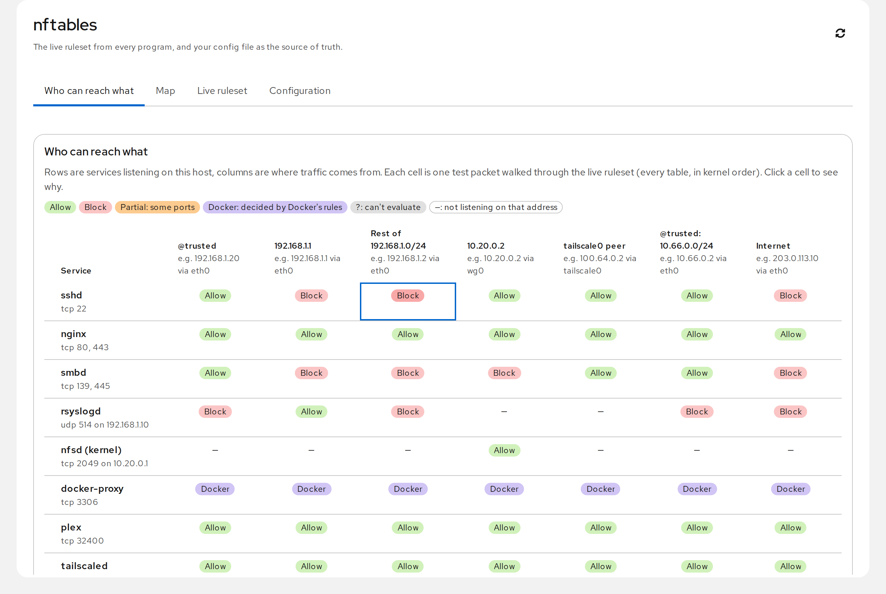
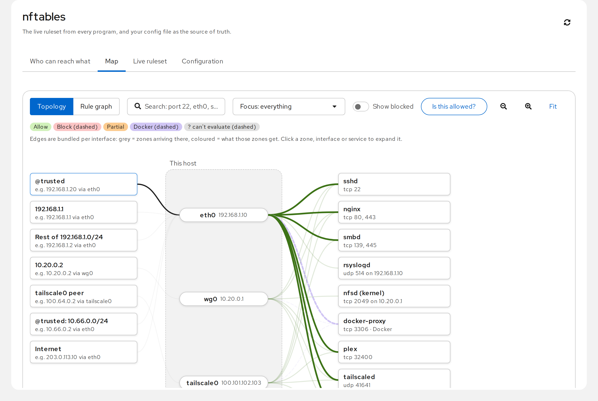
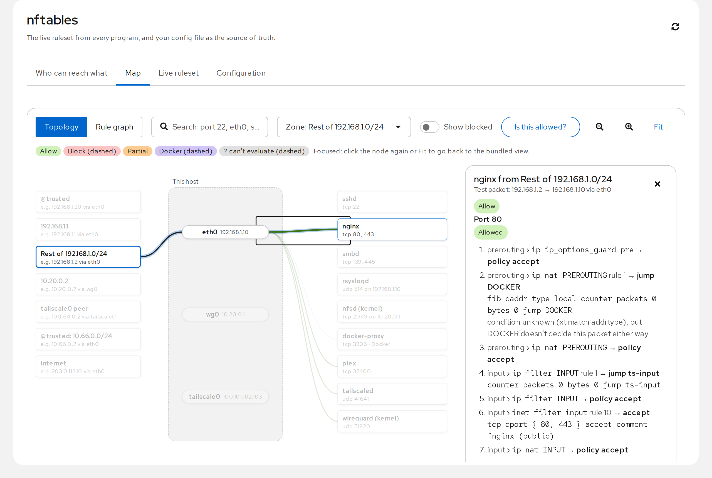
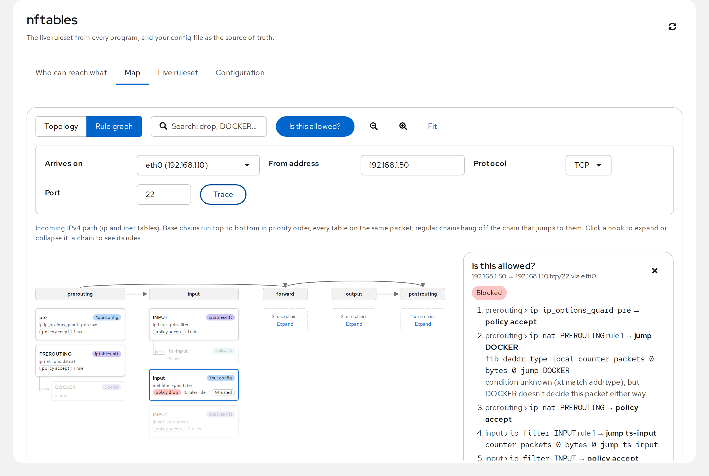
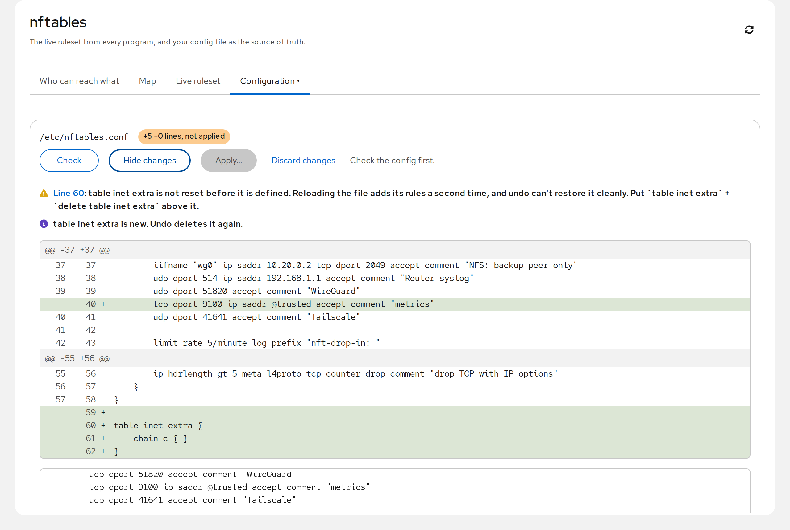
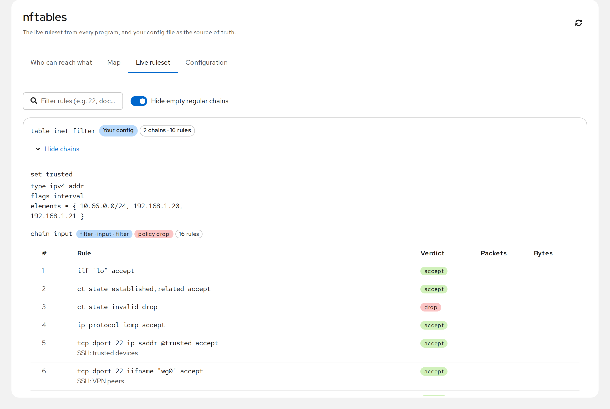
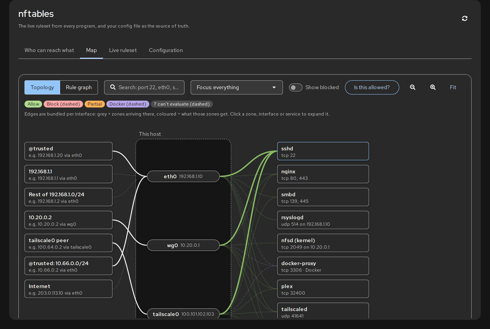

# cockpit-nftables

A [Cockpit](https://cockpit-project.org/) plugin for hosts with a **hand-written
nftables firewall**: see who can reach what, read the live ruleset from every
program that writes to it, and edit `/etc/nftables.conf` with validation and an
automatic undo.

**Status: proof of concept.** Read-only features are usable; applying changes
is off by default and should be treated as experimental.



## Why

Cockpit's built-in firewall page manages firewalld. Other GUIs either take over
the firewall with their own model, or manage only their own table. On a typical
server, though, several programs share the ruleset: your own config, Docker and
Tailscale (through iptables-nft), fail2ban. This plugin keeps **your config file
as the source of truth** and shows everything else read-only.

## Features

- **Who can reach what.** A zone matrix in the style of UniFi's: rows are the
  services listening on the host, columns are where traffic comes from (derived
  from interfaces and the sets/addresses your rules use). Each cell is a test
  packet walked through the live ruleset, across all tables in kernel priority
  order. Click a cell to see which chain and rule decided. Rules the evaluator
  can't read (iptables `xt` matches that would decide, maps) show as "?", never
  as a guess.
- **Is this allowed?** Enter an interface, source address, protocol and port and
  get the full trace (like a firewall's policy lookup / packet tracer).
- **Live ruleset.** Every table with owner labels (your config, iptables-nft
  with Docker/Tailscale hints, fail2ban), chains with hook/priority/policy, rules
  with verdicts and hit counters.
- **Configuration.** Edit the config file as text. `nft -c` validation, a diff
  against the file on disk, and pre-apply checks: `flush ruleset`, tables that
  aren't reset before being defined, tables owned by other programs, losing SSH.
- **Apply with auto-undo** (opt-in per host). Backs up the file, loads the new
  one with `nft -f` and arms a systemd timer that restores and reloads the
  previous file unless you confirm. Undo touches only the tables your file
  declares, so it is safe next to Docker/Tailscale rules that `nft` cannot
  re-parse.

## Screenshots

All screenshots show the demo server in [`test/demo/`](test/demo) and are
generated by `make screenshots` (see [Generating the screenshots](#generating-the-screenshots)).

| | |
|---|---|
|  |  |
| **Map, topology.** Zones -> interfaces -> services, bundled per interface; hovering a zone lights up what it reaches. | **Trace.** Focus a zone, click an edge: every chain the test packet passes, ending at the rule that decided. |
|  |  |
| **Rule graph.** Hooks left to right, base chains by priority across all tables; "Is this allowed?" lights up the path. | **Configuration.** Edit the file, review the diff, and get warnings before anything is applied. |
|  |  |
| **Live ruleset.** Every table, labelled by owner. | **Dark theme** follows Cockpit's setting. |

## Requirements

- Cockpit (tested with 362), nftables, `ss` and `ip` (iproute2), Python 3.
- The page needs administrative access in Cockpit.

## Install (development)

```sh
make                 # npm ci, fetch Cockpit's pkg/lib, build dist/
make devel-install   # symlink dist/ to ~/.local/share/cockpit/nftables (current user)
```

Applying is disabled until you opt in on that host:

```sh
sudo mkdir -p /etc/cockpit-nftables && sudo touch /etc/cockpit-nftables/apply-enabled
```

Your config should reset its own tables before defining them (and never use
`flush ruleset`), so it can be reloaded and undone cleanly:

```
table inet filter
delete table inet filter
table inet filter {
    ...
}
```

## Tests

```sh
make test                                     # unit tests (node --test)
sudo unshare --net sh test/helper-netns.sh    # helper end-to-end in an empty private network namespace
sudo sh test/sandbox-copy.sh                  # full apply / timer-undo / revert / confirm cycle against a
                                              # copy of this host's firewall in a throwaway network namespace;
                                              # the host's ruleset and config are fingerprinted before and after
```

## Generating the screenshots

```sh
npx playwright-core install chromium   # once, or have Google Chrome installed
make screenshots                        # = npm run screenshots
```

This builds a static preview of the UI, loads the demo firewall from
[`test/demo/`](test/demo) into a throwaway network namespace with the real
`nft` and `iptables-restore` (needs `sudo`; the host firewall is never
touched), and drives a headless browser through each view, writing
`docs/screenshots/*.png`. Change the demo data or the scenarios in
[`tools/screenshots/shoot.mjs`](tools/screenshots/shoot.mjs) and re-run.
`node tools/screenshots/shoot.mjs map-trace.png` re-renders a single one.

## Limits

IPv4 only, new connections only, one representative address per zone.
Docker-published ports are labelled as decided by Docker's rules rather than
evaluated.

## License

LGPL-2.1-or-later, like Cockpit and the starter kit it is based on.
